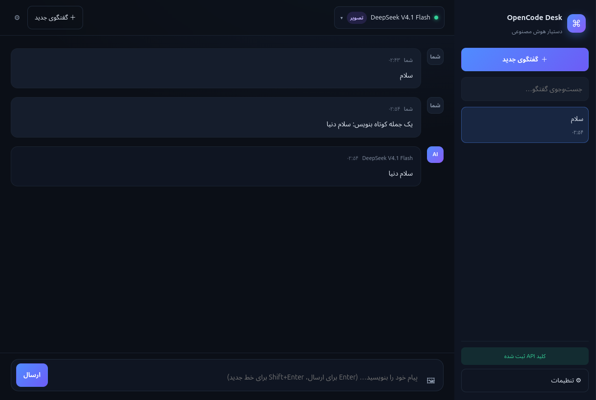
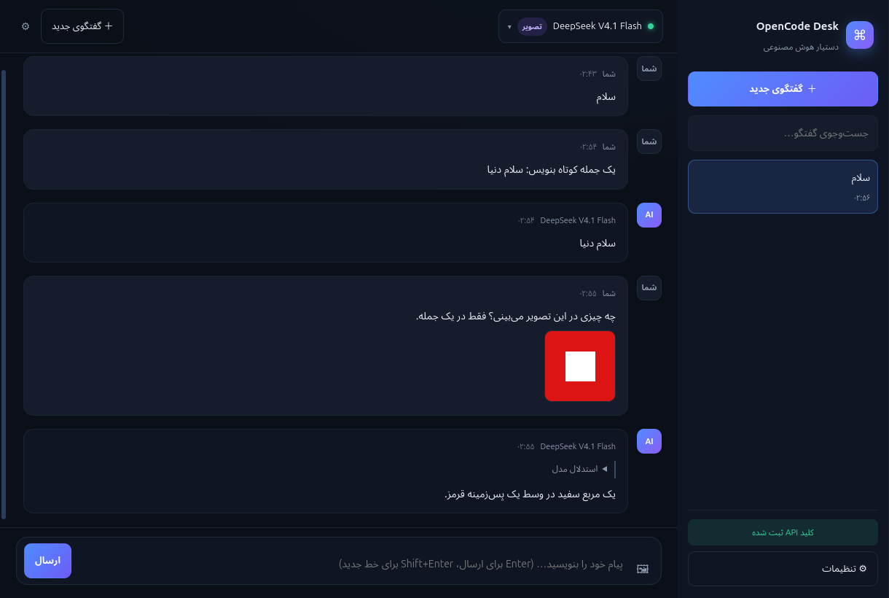

# OpenCode Desk — دستیار هوش مصنوعی رومیزی

اپلیکیشن دسکتاپ فارسی (راست‌به‌چپ) برای **OpenCode** روی **ویندوز** و **لینوکس**.
نصب می‌کنید، کلید API خودتان را می‌دهید و با مدل‌های DeepSeek، MiMo Flash و بقیه مدل‌های OpenCode چت می‌کنید — با تاریخچهٔ گفتگو، چند گفتگوی جدا و ارسال تصویر برای تحلیل.



## نصب

### ویندوز

| نسخه | لینک |
| --- | --- |
| نصب‌کننده (پیشنهادی) | [**OpenCodeDesk-win-x64.exe**](https://github.com/M-Hooshmand/opencode-desk/releases/latest/download/OpenCodeDesk-win-x64.exe) |
| نسخهٔ پرتابل (بدون نصب) | [OpenCodeDesk-Portable-1.0.0-x64.exe](https://github.com/M-Hooshmand/opencode-desk/releases/latest/download/OpenCodeDesk-Portable-1.0.0-x64.exe) |

فایل `exe` را اجرا کنید. ویندوز ممکن است هشدار SmartScreen بدهد (برنامه امضای تجاری ندارد): روی **More info → Run anyway** بزنید.

### لینوکس

| نسخه | لینک |
| --- | --- |
| AppImage (همهٔ توزیع‌ها) | [**OpenCodeDesk-linux-x86_64.AppImage**](https://github.com/M-Hooshmand/opencode-desk/releases/latest/download/OpenCodeDesk-linux-x86_64.AppImage) |
| بستهٔ Debian/Ubuntu | [OpenCodeDesk-linux-amd64.deb](https://github.com/M-Hooshmand/opencode-desk/releases/latest/download/OpenCodeDesk-linux-amd64.deb) |

```bash
# AppImage
chmod +x OpenCodeDesk-linux-x86_64.AppImage
./OpenCodeDesk-linux-x86_64.AppImage

# Debian / Ubuntu
sudo apt install ./OpenCodeDesk-linux-amd64.deb
```

همهٔ نسخه‌ها در صفحهٔ [Releases](https://github.com/M-Hooshmand/opencode-desk/releases) هستند.

## اولین اجرا

1. برنامه به‌طور خودکار **OpenCode CLI** نسخهٔ ۱.۱۹.۵ را دانلود و در پوشهٔ خودش نصب می‌کند (نیاز به اینترنت و حدود ۸۰ مگابایت دانلود).
2. کلید API خود را از [opencode.ai/auth](https://opencode.ai/auth) بگیرید و در پنجرهٔ شروع بچسبانید.
   اگر روی همین سیستم قبلاً OpenCode نصب کرده‌اید، دکمهٔ «یافتن کلید از نصب موجود» کلید را از نصب قبلی می‌خواند.
3. تمام. مدل پیش‌فرض `opencode-go/deepseek-v4.1-flash` است (تصویر و استدلال دارد).

کلید در `settings.json` و `data/opencode/auth.json` داخل پوشهٔ دادهٔ برنامه ذخیره می‌شود و از برنامهٔ OpenCode اصلی شما جدا است.

## امکانات

- **گفتگوهای جدا با تاریخچه** — ساخت، تغییر نام و حذف گفتگو؛ همه در پایگاه‌دادهٔ محلی OpenCode ذخیره می‌شوند.
- **ارسال تصویر** — انتخاب فایل، کشیدن و رها کردن، یا `Ctrl+V` در کادر پیام؛ مدل تصویر را می‌بیند و تحلیل می‌کند.
- **پاسخ زنده** — متن و «استدلال مدل» به‌صورت جریانی نمایش داده می‌شوند و می‌توانید وسط پاسخ متوقف کنید.
- **انتخاب مدل** — فهرست کامل مدل‌ها با برچسب «رایگان» و «تصویر»، جست‌وجو و مرتب‌سازی رایگان‌ها اول.
- **مدل‌های رایگان OpenCode** — مثل `deepseek-v4.1-flash-free`، `mimo-v2.6-flash-free`، `glm-5.3-flash-free` و `nemotron-3.5-super-vl-free` (این‌ها سهمیهٔ رایگان روزانه دارند و به اشتراک OpenCode Go نیاز ندارند).
- **مدل‌های اشتراک OpenCode Go** — مثل `opencode-go/deepseek-v4.1-flash` و `opencode-go/mimo-v2.6-flash`؛ نامحدودتر و پایدارتر.
- **فارسی و راست‌به‌چپ** با پوستهٔ تیره، Markdown و بلوک کد.
- **موتور ایزوله** — سرور OpenCode داخل خود برنامه و با پوشهٔ دادهٔ مستقل اجرا می‌شود؛ با نصب فعلی شما تداخل ندارد و به پورت عمومی گوش نمی‌دهد (فقط `127.0.0.1` با رمز تصادفی).



## ساخته‌شده روی چه چیزی

- [OpenCode](https://opencode.ai) به‌عنوان موتور مدل‌ها (CLI نسخهٔ ۱.۱۹.۵ به‌صورت خودکار نصب می‌شود)
- Electron + React + TypeScript
- ویرایشگر و ظاهر اختصاصی این پروژه

## ساخت از سورس

```bash
npm install
npm run dev        # اجرای حالت توسعه
npm run typecheck  # بررسی تایپ‌ها
npm run dist:linux # ساخت AppImage و deb  (روی لینوکس)
npm run dist:win   # ساخت نصب‌کننده و پرتابل ویندوز
```

خروجی‌ها در پوشهٔ `release/` ساخته می‌شوند. برای انتشار خودکار، تگ بزنید:

```bash
git tag v1.0.0 && git push origin v1.0.0
```

گردش‌کار `.github/workflows/release.yml` روی دو runner (اوبونتو و ویندوز) بیلد می‌کند و فایل‌ها را به همان Release می‌چسباند.

## مجوز

MIT
